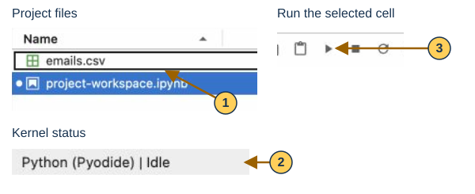
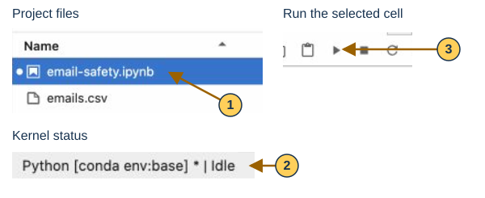
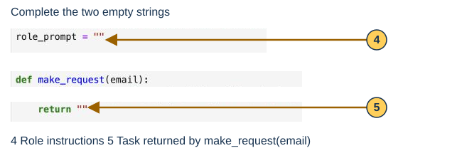

# Email Safety Assistant — project setup

## Provided files

This folder contains email-safety.ipynb, emails.csv and experiment.py. The organisations and messages are fictional. Complete the role_prompt and make_request(email) TODOs; leave the supplied request helper unchanged. The worked example is in the separate walkthrough folder.

## Browser workspace

Open the project notebook from your book's Environment Setup page. Wait for Python (Pyodide) to become idle. Check that emails.csv is beside project-workspace.ipynb. The figures are cropped screenshots of the actual interfaces. Callouts identify the project files (1), kernel status (2) and triangular Run button (3). The online filename differs from the downloaded email-safety.ipynb, but the task is the same.

Select a code cell and press Shift+Enter. Run in order and keep USE_OPENAI = False in the browser. Save with File → Save Notebook and download a copy using the file browser's Download command before leaving. Offline examples do not generate answers from edited prompts.



## Local JupyterLab

1. Extract the entire companion ZIP and keep its folders together.
2. Open a terminal at the package root, beside requirements.txt and COMPANION_VERSION.
3. Create and activate a Python environment. Follow the package-root README for Windows and macOS/Linux commands.
4. Install requirements.txt and start JupyterLab. From an activated environment:

```sh
python -m pip install -r requirements.txt
python -m jupyterlab
```

5. Open chapter-03-role-based-prompting/03-04-email-safety/email-safety.ipynb. Keep emails.csv beside it.
6. Choose the environment's Python kernel and run the data-loading cell with Shift+Enter. It should display messages E01–E04.
7. Complete role_prompt (4) and the return value of make_request(email) (5). Save the notebook in this folder.





## Optional live model requests

Copy .env.example to .env at the extracted package root and fill your own OPENAI_API_KEY and OPENAI_MODEL. The helper finds this file using COMPANION_VERSION. Never put a key into a notebook or screenshot.

Use a standard local Python kernel. Set USE_OPENAI = True and run the configuration cell. Only after completing the prompts, set RUN_DEVELOPMENT = True; its loop makes four requests. Read the results before repeating a call. Keep both switches false for offline work. Run clear_live() when finished.

## Complete the project

Predict first, use E01–E04 for development, then freeze the revised prompt for E05–E12. Record judgment, exact quoted evidence, next step and your own check. Label live, supplied and reader-written responses. Review the worked example only after your own attempt. There is nothing to submit.
